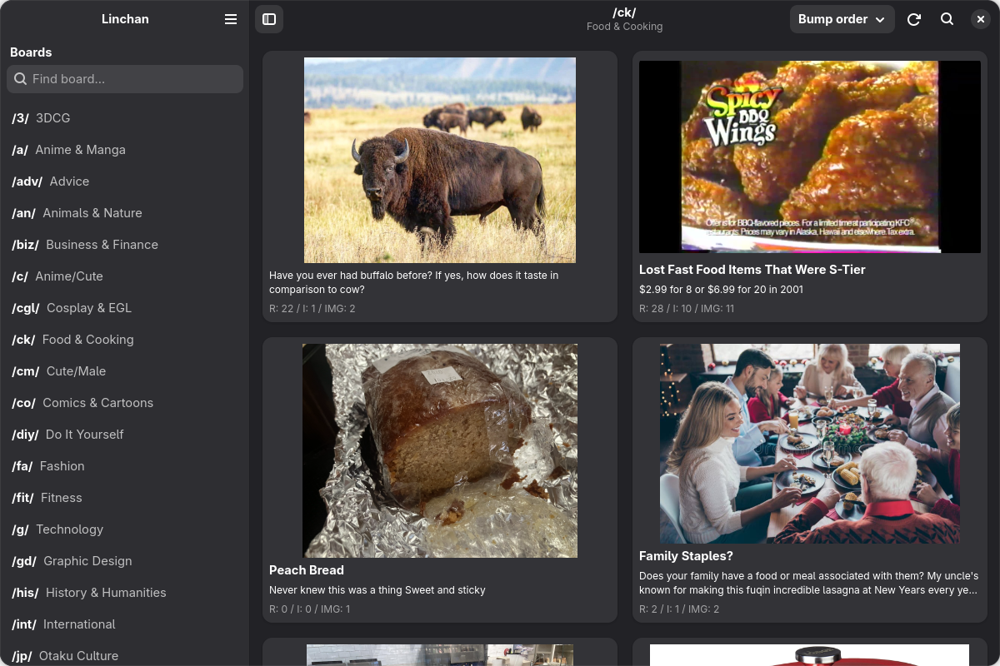
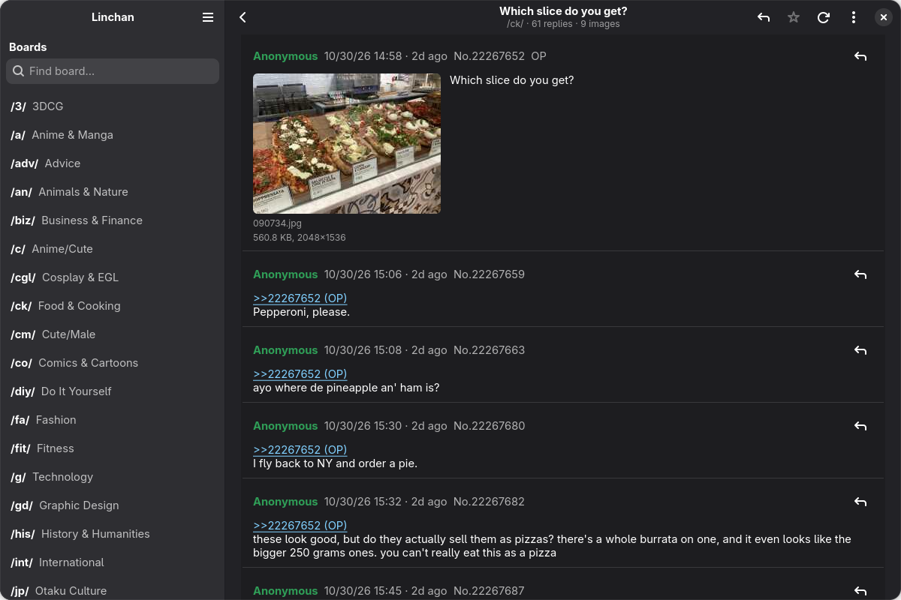

# Linchan

A native 4chan client for Linux. Fast, small, and no browser tab: it uses GTK 4 and libadwaita,
so it looks like any other GNOME app.

Linchan is an unofficial client. It is not affiliated with or endorsed by 4chan.




## Install

You do not need to build anything.

1. Go to the [Releases page](https://github.com/songanane/linchan/releases/latest) and download
   `linchan-<version>-x86_64.flatpak`.
2. Install it:
   ```sh
   flatpak install --user ./linchan-0.1.1-x86_64.flatpak
   ```
3. Start **Linchan** from your app menu, or run `flatpak run io.github.songanane.Linchan`.

That one file works on any distro with Flatpak: Fedora, Ubuntu, Debian, Arch, openSUSE, Mint,
SteamOS and so on. Flatpak is preinstalled on Fedora, Mint and SteamOS. On others, follow
[flatpak.org/setup](https://flatpak.org/setup/) first. The first install also downloads the GNOME
runtime (a few hundred MB, shared with other GNOME Flatpaks), so Flathub has to be added as a remote:
```sh
flatpak remote-add --user --if-not-exists flathub https://flathub.org/repo/flathub.flatpakrepo
```

To update, download the newer file and run the same install command again.
To remove it: `flatpak uninstall io.github.songanane.Linchan`.

Only x86_64 (normal 64-bit PCs and laptops) is built for now. On ARM you can build it yourself, see below.

## Features
- Board list with search, optional hiding of not-safe-for-work boards
- Catalog grid: filter, sort by bump order, last reply, replies, images, newest or oldest
- Threads with greentext, spoilers, `>>` quote links that jump to the post, reply links and cross-thread links
- Hover a `>>` link to preview the quoted post; plain URLs in posts are clickable
- Live refresh every 15 s, "N new posts" toast, 404 and archived banners
- Media viewer: images, animated GIFs, webm/mp4, click to zoom, fullscreen, save, open externally, jump to the post, reverse image search (Google Lens, Yandex, IQDB, SauceNAO, TinEye)
- Reply to threads and quote single posts, with optional attachments
- Download every file in a thread to a folder you choose
- Watch list with unread counts
- Open any thread or board URL with Ctrl+L

## Keyboard
| Key | Action |
| --- | --- |
| Ctrl+L | Open a URL or board |
| Ctrl+R / F5 | Refresh |
| Alt+Left / Backspace | Back |
| F9 | Toggle the board sidebar |
| Ctrl+F | Filter the catalog |

In the media viewer: ←/→ navigate, F fullscreen, S save, O open externally, G go to post, Space pause, Esc close.

## Good to know
- **Posting.** Replies go through 4chan's own Quick Reply inside a small embedded browser view, because posting sits behind Cloudflare and 4chan's captcha. You solve the captcha yourself. Linchan does not solve, fake or bypass anything. Replies only for now: no new threads and no 4chan Pass login. Posting needs a normal Flatpak install. Running from source on some distros can fail with "Please unblock spur.us and mcl.io", which is a bug in an old system libsoup.
- **Unofficial.** 4chan only has a read-only API. Posting through a third-party app may break when the site changes, and the site can still ban you for how you post.
- **Reading is polite.** At most one request per second, with `If-Modified-Since`, as the API rules ask.
- **Video.** webm plays out of the box. mp4 (H.264) depends on your codecs; otherwise use "open externally".
- **Your data.** Settings and the watch list are stored locally. The media cache is pruned after 7 days. No telemetry, no accounts. Reading only talks to 4chan's API and CDN. The reply window also loads 4chan's captcha, Cloudflare and `mcl.spur.us`, like a browser would, and keeps their cookies in its own folder. Reverse image search only runs when you pick an engine. In the Flatpak, files are saved through the system file chooser.
- **Clearing cookies.** Menu, then "Clear Browsing Data…" deletes everything the reply window stored: cookies, cache, Cloudflare clearance and any 4chan Pass login. Reading threads stores none of it.
- **Content.** Boards contain unmoderated content from anonymous users that may be offensive or explicit. Use "Hide NSFW boards" in the menu if you want.

## Made with AI
Most of this code was written with AI under my direction. I use it and test it daily, but
expect rough edges. Bug reports and pull requests are welcome.

## Build from source
Needs:
 - Python 3
 - PyGObject
 - GTK 4.12+
 - libadwaita 1.5+
 - WebKitGTK 6.0
 - GStreamer good plugins

With [uv](https://docs.astral.sh/uv/) (the system provides GTK and PyGObject, uv manages the rest):
```sh
./bin/linchan                  # creates .venv on first run, then starts the app
uv run ruff check .            # lint
```
`./bin/linchan` falls back to plain `python3 -m linchan` if uv is not installed. Posting may hit the
libsoup bug above when run from source.
Or build and install the Flatpak from this folder (also works on ARM):
```sh
flatpak install flathub org.gnome.Platform//51 org.gnome.Sdk//51
./install-local.sh
```
Or with meson:
```sh
meson setup build --prefix=/usr/local && meson compile -C build && sudo meson install -C build
```

## Testing without posting
Set `LINCHAN_DRY_RUN=1` and the reply dialog fills the form but never sends it. `LINCHAN_DEBUG=1` logs the
dialog's network requests (without query strings).

## License
GPL-3.0-or-later. See `LICENSE`.
